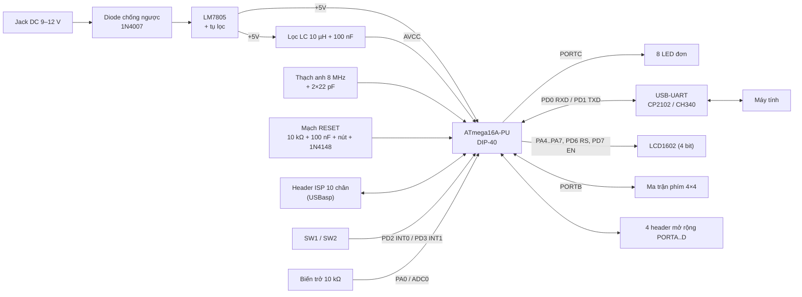

# Tuần 1 (16/09 – 22/09/2026): Phân tích yêu cầu và sơ đồ khối

## 1. Mục tiêu đề tài

- Thiết kế bo KIT ATmega16 dựa trên sơ đồ tham khảo và datasheet.
- Làm đủ quy trình: schematic → PCB → hàn lắp → kiểm tra bo.
- Lập trình và kiểm thử các ngoại vi: GPIO, ngắt, Timer, ADC, UART, LCD, ma trận phím.
- Ghép các khối thành bài tập tổng hợp theo yêu cầu của GVHD.
- Xây dựng quy trình đo kiểm, ghi lỗi và xác nhận cách khắc phục.

## 2. Yêu cầu chức năng

| Mã | Yêu cầu | Cách kiểm chứng |
|----|---------|-----------------|
| FR1 | Bo được cấp nguồn đúng, không chập; ATmega16 nạp được chương trình | Đo VCC/AVCC = 5 V ± 5 %, nạp USBasp đọc đúng chữ ký `1E 94 03` |
| FR2 | GPIO điều khiển LED và đọc nút nhấn | Bài `01_gpio_led`, `02_button` |
| FR3 | Ngắt ngoài phát hiện đúng sự kiện | Bài `03_ext_interrupt` (INT0/INT1 cạnh xuống) |
| FR4 | Timer/Counter tạo chu kỳ, sự kiện định thời | Bài `04_timer`: OC1A = 1 kHz, tick 1 ms |
| FR5 | ADC đọc điện áp biến trở, trả về giá trị hợp lý | Bảng so sánh điện áp đo – giá trị ADC |
| FR6 | UART truyền/nhận với máy tính | Log terminal 9600 8N1 |
| FR7 | LCD1602 hiển thị dữ liệu và trạng thái | Ảnh/video LCD |
| FR8 | Quét ma trận phím 4×4, chống dội | Log phím nhấn, thử nhấn giữ/nhấn nhanh |
| FR9 | Ghép ngoại vi thành bài tổng hợp | Video demo |
| FR10 | Mỗi bước có mã nguồn và minh chứng | Thư mục `firmware/`, `docs/`, commit Git |

## 3. Sơ đồ khối hệ thống

## 4. Các khối chức năng (theo datasheet ATmega16 và AN2519)

| Khối | Nội dung chính | Ghi chú thiết kế |
|------|----------------|------------------|
| Nguồn | Jack DC → 1N4007 → LM7805 → +5 V | Tụ 470 µF + 100 nF đầu vào, 100 µF + 100 nF đầu ra; LED báo nguồn |
| Clock | Thạch anh 8 MHz, 2 tụ 22 pF | Fuse CKSEL = 1111, SUT = 11 |
| Reset | Kéo lên 10 kΩ, tụ 100 nF, nút nhấn, diode 1N4148 về VCC | Theo khuyến nghị AN2519, tương thích nạp ISP |
| Nguồn analog | AVCC qua cuộn 10 µH + tụ 100 nF; AREF có tụ 100 nF | Datasheet: AVCC chênh VCC không quá ±0.3 V |
| Nạp ISP | Header 10 chân chuẩn USBasp (MOSI, MISO, SCK, RESET) | Jumper JP1 cho phép lấy 5 V từ mạch nạp |
| Ngoại vi | LED, nút, biến trở, UART, LCD, keypad, header cổng | Xem bảng phân chân tuần 2 |

## 5. Tài liệu tham khảo đã phân loại

| Loại | Tài liệu | Dùng cho |
|------|----------|----------|
| Datasheet | Microchip, *ATmega16/ATmega16A Datasheet* (DS40002007) | Sơ đồ chân, đặc tính điện, thanh ghi ngoại vi, fuse |
| Ứng dụng | Microchip *AN2519 – AVR Microcontroller Hardware Design Considerations* | Mạch reset, tụ thoát, lọc AVCC, mạch dao động |
| Datasheet | LM7805, 1N4007, 1N4148, HD44780 (LCD1602) | Khối nguồn, giao tiếp LCD |
| Giáo trình | Schematic tham khảo và yêu cầu bài tập do GVHD cung cấp | Đối chiếu kết nối, bài tập tổng hợp |
| Phần mềm | KiCad 10 – tài liệu Eeschema/Pcbnew; avr-gcc, avr-libc, avrdude | Thiết kế mạch, biên dịch, nạp |
| Mô phỏng | Proteus 8 / SimulIDE | Chạy thử firmware khi chưa có bo |

Bản khảo sát tài liệu chi tiết tuần 1: xem link Google Docs trong `docs/bao-cao-tuan/PhieuBaoCaoTuan1.docx`.
