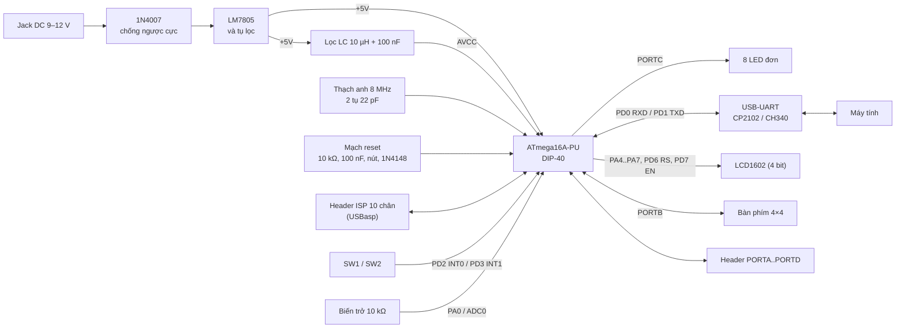

# Tuần 1 (16/09 – 22/09/2026): Tìm hiểu yêu cầu và lập sơ đồ khối

## 1. Mục tiêu

Tuần đầu tập trung đọc đề tài, datasheet ATmega16 và tài liệu AN2519 để nắm được bo KIT cần có những
khối gì. Mục tiêu chung của đề tài:

- Thiết kế bo KIT ATmega16 dựa trên sơ đồ tham khảo và datasheet.
- Làm trọn quy trình từ schematic, PCB đến hàn lắp và kiểm tra bo.
- Viết chương trình thử cho từng ngoại vi: GPIO, ngắt, Timer, ADC, UART, LCD, bàn phím.
- Ghép các phần lại thành một bài tổng hợp theo yêu cầu của thầy.
- Ghi lại quá trình đo kiểm, các lỗi gặp phải và cách sửa.

## 2. Yêu cầu chức năng

| Mã | Yêu cầu | Kiểm tra bằng cách |
|----|---------|--------------------|
| FR1 | Bo lên nguồn đúng, không chập, ATmega16 nạp được chương trình | Đo VCC/AVCC khoảng 5 V; avrdude đọc đúng chữ ký `1E 94 03` |
| FR2 | GPIO bật tắt được LED và đọc được nút nhấn | Bài `01_gpio_led`, `02_button` |
| FR3 | Ngắt ngoài bắt đúng sự kiện | Bài `03_ext_interrupt` |
| FR4 | Timer tạo được chu kỳ, sự kiện định thời | Bài `04_timer`: OC1A ra 1 kHz, tick 1 ms |
| FR5 | ADC đọc điện áp biến trở ra giá trị hợp lý | So sánh điện áp đo được với giá trị ADC |
| FR6 | UART gửi nhận được với máy tính | Log trên terminal, 9600 8N1 |
| FR7 | LCD1602 hiển thị được dữ liệu | Ảnh hoặc video |
| FR8 | Quét được bàn phím 4×4, có chống dội | Log phím nhấn |
| FR9 | Các ngoại vi chạy chung trong bài tổng hợp | Video demo |
| FR10 | Bước nào cũng có mã nguồn và minh chứng | Thư mục `firmware/`, `docs/` và lịch sử commit |

## 3. Sơ đồ khối

## 4. Các khối chính

- **Nguồn:** điện áp từ jack DC qua 1N4007 để chống cắm ngược, rồi vào LM7805 lấy ra 5 V. Đầu vào có tụ
  470 µF và 100 nF, đầu ra có 100 µF và 100 nF, thêm một LED báo nguồn.
- **Dao động:** thạch anh 8 MHz với hai tụ 22 pF. Fuse đặt CKSEL = 1111, SUT = 11.
- **Reset:** điện trở kéo lên 10 kΩ, tụ 100 nF, nút nhấn và một diode 1N4148 về VCC như AN2519 gợi ý.
  Mạch này vẫn để nạp ISP bình thường.
- **Nguồn analog:** AVCC lấy từ 5 V qua cuộn 10 µH và tụ 100 nF, AREF có tụ 100 nF xuống GND. Datasheet
  yêu cầu AVCC không lệch VCC quá ±0,3 V.
- **Nạp ISP:** header 10 chân theo chuẩn USBasp. Jumper JP1 dùng khi muốn lấy nguồn 5 V từ mạch nạp.
- **Ngoại vi:** LED, nút nhấn, biến trở, UART, LCD, bàn phím và các header mở rộng. Cách nối chi tiết
  ở phần phân chân tuần 2.

## 5. Tài liệu tham khảo

- Microchip, *ATmega16/ATmega16A Datasheet*: sơ đồ chân, đặc tính điện, thanh ghi ngoại vi, fuse.
- Microchip, *AN2519 – AVR Microcontroller Hardware Design Considerations*: mạch reset, tụ thoát, lọc
  AVCC, mạch dao động.
- Datasheet LM7805, 1N4007, 1N4148, HD44780 (LCD1602).
- Schematic tham khảo và yêu cầu bài tập thầy cung cấp.
- Tài liệu KiCad, avr-gcc, avr-libc, avrdude; Proteus để mô phỏng.

Bản khảo sát tài liệu đầy đủ của tuần 1 có link trong phiếu báo cáo `docs/bao-cao-tuan/PhieuBaoCaoTuan1.docx`.
