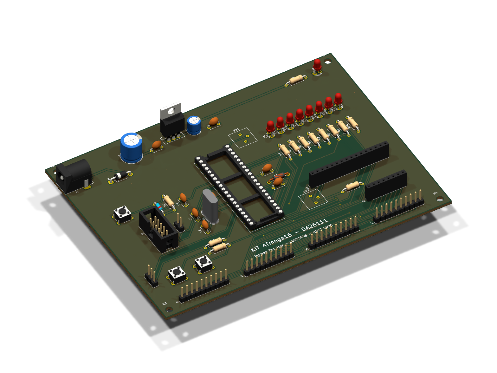

# Tuần 4 (07/10 – 13/10/2026): Vẽ PCB 2 lớp, chạy DRC, xuất Gerber

## 1. Kết quả

- File PCB: [`hardware/kicad/KIT-ATmega16.kicad_pcb`](../../hardware/kicad/KIT-ATmega16.kicad_pcb)
- Báo cáo DRC: [`hardware/kicad/drc.rpt`](../../hardware/kicad/drc.rpt)
- Gerber và file khoan để gửi đặt mạch: [`hardware/output/KIT-ATmega16-gerber.zip`](../../hardware/output/KIT-ATmega16-gerber.zip)
- Ảnh 3D mặt trên, mặt dưới, góc nghiêng: `hardware/output/KIT-ATmega16-3d-*.png`
- Bản in từng lớp để in 1:1 ướm linh kiện: `hardware/output/KIT-ATmega16-*.pdf`

## 2. Thông số bo

- Kích thước 150 × 110 mm, 2 lớp, có 4 lỗ bắt vít M3 ở bốn góc.
- 57 linh kiện, tất cả là loại chân cắm để dễ hàn tay.
- Dây tín hiệu rộng 0,4 mm, dây nguồn (+5V, GND, VIN, AVCC) rộng 0,8 mm.
- Khoảng cách giữa các đường 0,3 mm, cách mép bo 0,3 mm.
- Via 1,0/0,5 mm cho tín hiệu và 1,2/0,6 mm cho nguồn, tổng cộng 22 via.
- Đổ đồng GND cả hai mặt, pad nối vào vùng đồng qua thermal relief cho dễ hàn.

Các thông số này nằm trong khả năng của các xưởng làm mạch phổ thông như JLCPCB hay PCBWay.

## 3. Cách bố trí

- **Góc trên bên trái** là khối nguồn: jack DC sát mép trái, sau đó tới 1N4007, tụ lọc và LM7805. Phía trên
  LM7805 để trống một chút để gắn tản nhiệt nếu cần.
- **Ở giữa** là đế DIP-40 của MCU. Thạch anh và hai tụ 22 pF đặt sát chân 12, 13; C10 sát chân VCC;
  L1, C8, C9 đặt cạnh chân AVCC và AREF.
- **Bên trái** là nút reset cùng R2, C5, D3, header ISP, jumper JP1 và header UART.
- **Bên phải** là dãy 8 LED với điện trở, biến trở ADC đặt gần PA0, socket LCD1602 và socket bàn phím.
- **Mép dưới** là 4 header PORTA–PORTD (mỗi header có thêm chân +5V và GND) và hai nút SW1, SW2.

## 4. Kiểm tra

- DRC trên KiCad 10.0.6 không còn lỗi, không còn chỗ nào chưa nối, và PCB khớp với schematic.
- Còn 17 cảnh báo về silkscreen: tên LED đè lên viền LED bên cạnh, chữ H1/H2 sát mép bo. Các cảnh báo này
  chỉ ảnh hưởng tới hình thức, sẽ sửa trước khi gửi đặt mạch.

## 5. Việc cần làm trước khi đặt mạch

- [ ] Xem lại đường đi dây quanh MCU, chỉnh lại những đoạn vòng xa.
- [ ] Dời các chữ silkscreen bị chồng, chạy lại DRC.
- [ ] In các lớp tỉ lệ 1:1, đặt thử LM7805, jack DC, biến trở và nút nhấn lên giấy.
- [ ] Gửi thầy xem layout rồi mới đặt mạch.
